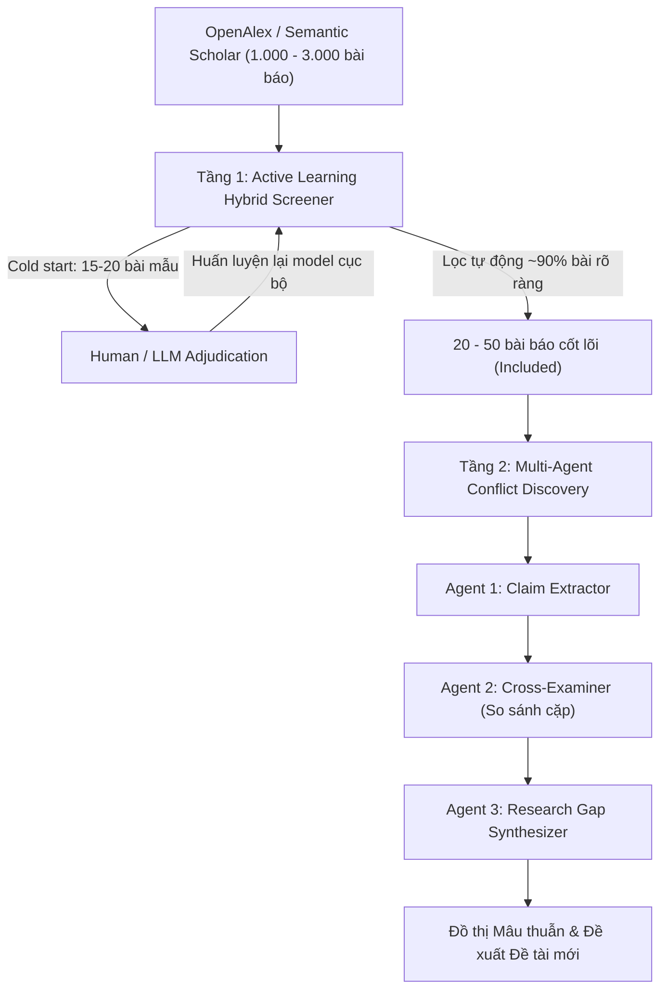
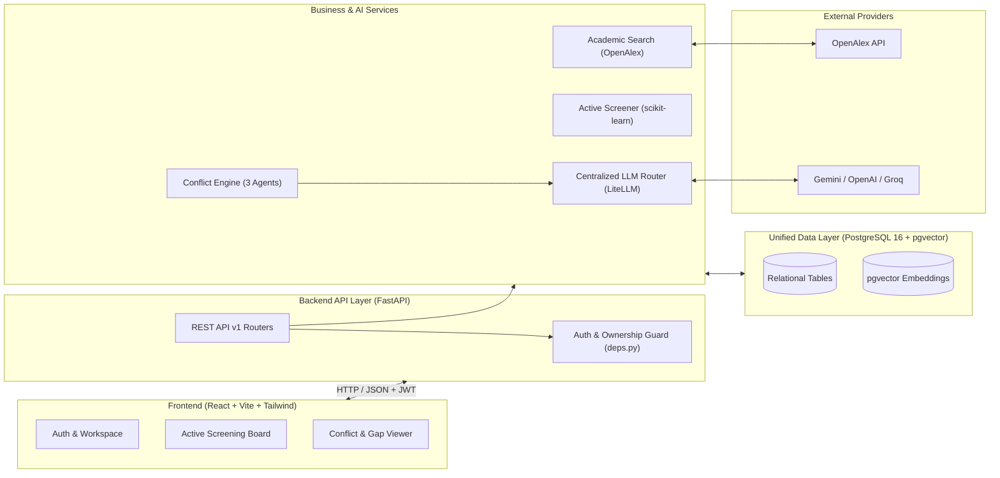
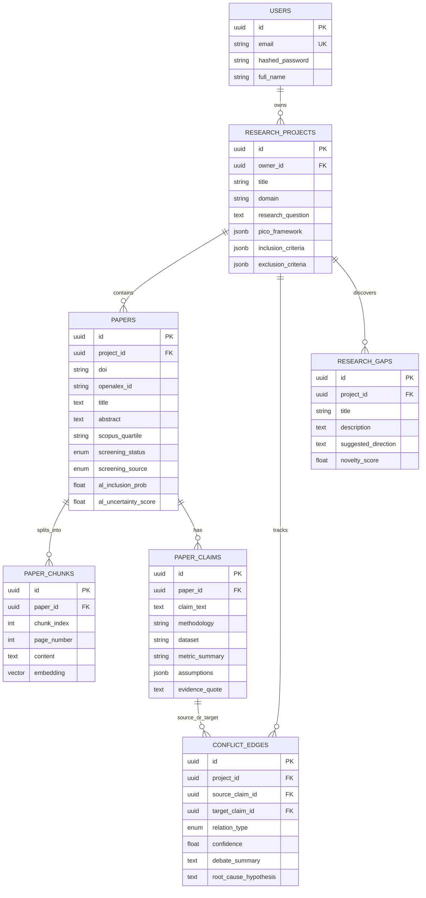
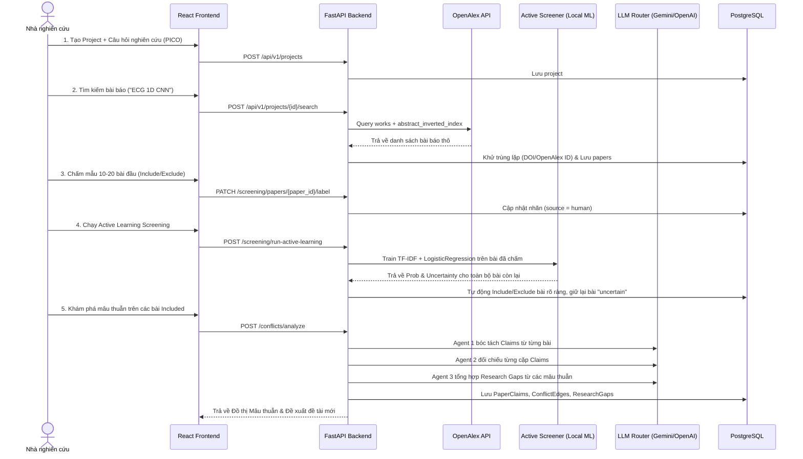

# 01. Tổng quan Kiến trúc Hệ thống (Architecture Overview)

Tài liệu này mô tả bức tranh tổng thể về kiến trúc kỹ thuật, mô hình dữ liệu và luồng đi của dữ liệu trong **LitNexus**.

---

## 1. Triết lý thiết kế cốt lõi: "The Research Funnel"

Thay vì dùng AI đắt đỏ để đọc toàn bộ hàng nghìn bài báo một cách mù quáng (tốn chi phí token, chậm và nhiều nhiễu), LitNexus tổ chức quy trình **Systematic Literature Review (SLR)** thành 2 tầng phễu kế tiếp nhau:

---

## 2. Kiến trúc Phân tầng (Layered Architecture)

### Nguyên tắc kiến trúc bất di bất dịch
1. **1 Cổng LLM duy nhất (`llm_router.py`)**: Mọi tác vụ gọi AI đều đi qua `LiteLLM` với cơ chế fallback tự động và ép kiểu JSON bằng Pydantic. Không gọi SDK của Gemini/OpenAI rải rác trong code nghiệp vụ.
2. **1 Database hợp nhất (`PostgreSQL + pgvector`)**: Dữ liệu quan hệ (User, Project, Paper, Claim, Edge) và vector nhúng (PDF chunks) nằm chung 1 database, đảm bảo giao dịch ACID và xóa dữ liệu theo cascade sạch sẽ.
3. **Cô lập đa người dùng nghiêm ngặt (Multi-tenant Isolation)**: Mọi endpoint liên quan đến `project_id` đều phải đi qua dependency `get_owned_project`, đảm bảo user A không bao giờ truy vấn nhầm bài báo hoặc tài liệu của user B.

---

## 3. Lược đồ Cơ sở dữ liệu (Database ERD)

---

## 4. Luồng xử lý End-to-End (Sequence Flow)

