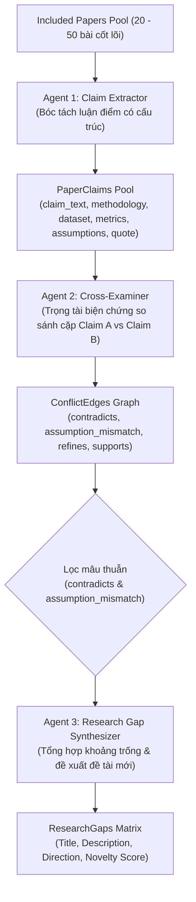
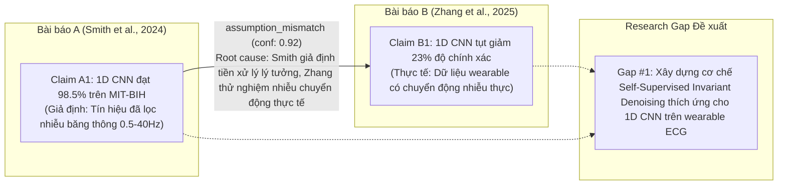

# 04. Động cơ Tranh biện & Đồ thị Mâu thuẫn Đa Agent (Multi-Agent Conflict Engine)

Tài liệu này chi tiết hóa kiến trúc kỹ thuật của **Stage 2: Cross-Paper Multi-Agent Conflict Discovery**, bao gồm mô hình phân tầng 3 Agent, taxonomy phân loại quan hệ học thuật, giao thức đối thoại biện chứng (Advocate vs. Challenger), và lược đồ biểu diễn đồ thị mâu thuẫn (Conflict Graph).

---

## 1. Mục tiêu & Bài toán Khoa học

Trong các bài tổng quan tài liệu truyền thống, các công cụ AI thông thường (RAG đơn giản) chỉ dừng lại ở mức tóm tắt độc lập từng bài báo hoặc trả lời câu hỏi tìm kiếm ngữ nghĩa đơn lẻ. Điều này bỏ sót thông tin quan trọng nhất trong nghiên cứu khoa học: **Sự bất đồng học thuật (Scientific Debate)** và **Mâu thuẫn thực nghiệm (Empirical Contradictions)** giữa các nhóm tác giả.

Stage 2 của LitNexus giải quyết vấn đề này bằng một chuỗi phối hợp giữa 3 Agent AI chuyên biệt:



---

## 2. Chi tiết 3 Agent & Giao thức Hoạt động

### 2.1. Agent 1: Claim Extractor (`extract_paper_claims`)

- **Vai trò**: Đóng vai trò chuyên gia phân tích bài báo, đọc toàn văn hoặc abstract để bóc tách 1–3 luận điểm khoa học có thể kiểm chứng được (verifiable claims).
- **Quy tắc trích xuất**:
  - Không trích xuất các câu nhận định chung chung (e.g., "AI is important").
  - Bắt buộc phải gắn với phương pháp cụ thể (`methodology`), tập dữ liệu thực nghiệm (`dataset`), chỉ số định lượng đo đạc được (`metric_summary`), và các giả định ngầm định (`assumptions`).
  - Phải trích xuất câu văn nguyên bản (`evidence_quote`) làm bằng chứng không thể chối cãi.
- **Pydantic Schema**:
  ```python
  class ExtractedClaimSchema(BaseModel):
      claim_text: str = Field(description="Core empirical or methodological claim.")
      methodology: str = Field(description="Primary model, algorithm, or experimental setup.")
      dataset: str = Field(description="Datasets or testbeds evaluated.")
      metric_summary: str = Field(description="Key quantitative findings (e.g., F1=0.92, Latency=12ms).")
      assumptions: list[str] = Field(default_factory=list, description="Explicit or implicit conditions.")
      evidence_quote: str = Field(description="Verbatim snippet from the paper as evidence.")
  ```

---

### 2.2. Agent 2: Cross-Examiner (`cross_examine_claims`)

- **Vai trò**: Đóng vai trò **Trọng tài Biện chứng (Dialectical Moderator)** giữa hai bài báo.
- **Giao thức Tranh biện**:
  - Mô phỏng cuộc đối thoại giữa **Advocate của Bài A** và **Challenger của Bài B**.
  - So sánh đối chiếu hai bộ `(methodology, dataset, metric_summary, assumptions)`.
  - Phân loại mối quan hệ theo hệ phân loại 4 nhãn (Taxonomy).

#### Taxonomy Quan hệ Học thuật:
| Nhãn quan hệ | Ý nghĩa học thuật | Điều kiện kích hoạt |
|---|---|---|
| `contradicts` | Mâu thuẫn thực nghiệm trực tiếp | Hai nghiên cứu cùng thử nghiệm trên cùng điều kiện/bài toán nhưng đưa ra kết luận hoặc kết quả hiệu năng trái ngược nhau. |
| `assumption_mismatch` | Xung đột do lệch giả định | Kết quả khác nhau nhưng bắt nguồn từ các giả định ngầm định khác nhau (vd: tập dữ liệu sạch vs tập dữ liệu có nhiễu; phân phối dữ liệu i.i.d vs out-of-distribution). |
| `refines` | Tinh chỉnh & mở rộng phạm vi | Bài B xác định lại ranh giới hoạt động, bổ sung điều kiện biên, hoặc cải tiến phương pháp của Bài A. |
| `supports` | Đồng thuận thực nghiệm | Hai nghiên cứu độc lập sử dụng phương pháp hoặc tập dữ liệu khác nhau nhưng cùng xác nhận một quy luật/kết luận khoa học. |

- **Root Cause Hypothesis**: Agent 2 bắt buộc phải đưa ra giả thuyết giải thích *tại sao* mâu thuẫn này lại tồn tại (vd: do shift phân phối dữ liệu, độ sâu mạng neuron, kích thước batch, hay cách chuẩn hóa tín hiệu).

---

### 2.3. Agent 3: Research Gap Synthesizer (`synthesize_research_gaps`)

- **Vai trò**: Nhà hoạch định chiến lược nghiên cứu cấp cao (Senior Research Director).
- **Cơ chế tổng hợp**:
  - Gom toàn bộ các mâu thuẫn loại `contradicts` và `assumption_mismatch` phát hiện được từ Agent 2.
  - Đối chiếu với câu hỏi nghiên cứu gốc của dự án (`research_question`).
  - Tổng hợp ra danh sách **Top 3 Research Gaps** mang tính đột phá và có thể kiểm chứng được bằng thực nghiệm (testable hypotheses).
- **Novelty Score ($S_{\text{novelty}} \in [0.0, 1.0]$)**:
  - Đánh giá dựa trên mức độ bất đồng chưa được giải quyết giữa các bài báo cốt lõi và tính khả thi trong việc thiết kế thực nghiệm hòa giải mâu thuẫn đó.

---

## 3. Cấu trúc Đồ thị Mâu thuẫn (Conflict Graph Data Model)

Dữ liệu mâu thuẫn được lưu trữ dưới dạng đồ thị có hướng (Directed Graph) trong PostgreSQL:
- **Node**: Đại diện cho các bài báo (`Paper`) và từng luận điểm bóc tách (`PaperClaim`).
- **Edge**: Đại diện cho quan hệ biện chứng giữa hai Claim (`ConflictEdge`) kèm độ tin cậy (`confidence`), tóm tắt tranh biện (`debate_summary`), và giả thuyết nguyên nhân gốc rễ (`root_cause_hypothesis`).



---

## 4. Tối ưu Hiệu năng & Kiểm soát Chi phí Token

Nếu có $N$ bài báo, mỗi bài bóc tách $K$ claims, việc so sánh toàn bộ các cặp $O((N \cdot K)^2)$ sẽ rất tốn kém chi phí gọi LLM. LitNexus áp dụng chiến lược tối ưu phân tầng:
1. **Giai đoạn khởi tạo (Sprint 1-2)**: Giới hạn tối đa 10 bài báo cốt lõi và 1 claim đại diện nhất cho mỗi bài báo ($N=10, K=1 \implies \binom{10}{2} = 45$ phép so sánh cặp).
2. **Giai đoạn nâng cao (Semantic Pre-filtering với pgvector)**:
   - Tạo vector nhúng (embedding 1536 chiều) cho từng `claim_text` và `methodology`.
   - Tính Cosine Similarity giữa các vector claim.
   - **Chỉ kích hoạt Agent 2** cho các cặp claim có Cosine Similarity $\ge 0.65$ (cùng trường chủ đề/bài toán), giảm 70% số lượng request so sánh vô nghĩa giữa hai bài báo bàn về hai phạm trù không liên quan.
