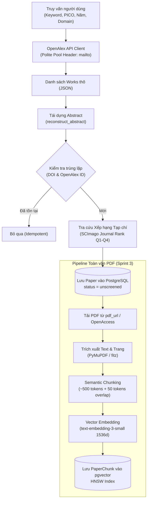

# 05. Pipeline Thu thập Dữ liệu & Xếp hạng Học thuật (Data Pipeline & SJR)

Tài liệu này giải thích chi tiết quy trình thu thập dữ liệu bài báo từ các cơ sở dữ liệu học thuật mở, thuật toán tái dựng văn bản, cơ chế khử trùng lặp, hệ thống tra cứu xếp hạng tạp chí SCImago Journal Rank (SJR Q1–Q4), và kỹ thuật phân mảnh toàn văn PDF vào vector store `pgvector`.

---

## 1. Kiến trúc Pipeline Thu thập Dữ liệu



---

## 2. Kết nối OpenAlex API & Giải mã Abstract Inverted Index

### 2.1. Tại sao chọn OpenAlex?
- **Miễn phí 100%**: Hạn mức hào phóng lên tới 100.000 requests/ngày khi gắn email vào header `User-Agent` (Polite Pool).
- **Quy mô lớn**: Hơn 250 triệu công trình nghiên cứu, chỉ mục trích dẫn đầy đủ và liên kết DOI.
- **Hỗ trợ lọc sâu**: Lọc sẵn các bài báo có abstract bằng tham số `filter=has_abstract:true`, lọc theo năm xuất bản, ngôn ngữ tiếng Anh, hoặc loại ấn phẩm.

### 2.2. Thuật toán Tái dựng Abstract từ `abstract_inverted_index`
OpenAlex không lưu abstract dưới dạng văn bản thô nhằm tối ưu dung lượng và tuân thủ bản quyền tóm tắt. Dữ liệu trả về có dạng:
```json
{
  "abstract_inverted_index": {
    "Deep": [0],
    "learning": [1, 14],
    "models": [2],
    "outperform": [3],
    "traditional": [4],
    "methods": [5]
  }
}
```

Hàm `reconstruct_abstract()` trong [academic_search.py](file:///d:/BuildMorrow/LitNexus/backend/app/services/academic_search.py) tái dựng lại đoạn văn theo thuật toán vị trí:
1. Duyệt qua từng cặp `(word, positions)` trong inverted index.
2. Tìm vị trí lớn nhất $\max(\text{positions})$ để xác định kích thước mảng từ.
3. Gán từ vào mảng tại các chỉ số vị trí tương ứng.
4. Ghép lại thành chuỗi văn bản hoàn chỉnh với độ phức tạp thời gian $O(W)$, trong đó $W$ là số lượng từ trong abstract:

$$\text{FullText} = \text{Join}\Big(\big[w_0, w_1, w_2, \dots, w_N\big]\Big)$$

---

## 3. Cơ chế Khử trùng lặp Đa tầng (Multi-tier Deduplication)

Trong Systematic Literature Review, một lỗi phổ biến là cùng một bài báo xuất hiện nhiều lần (bản in sớm ArXiv, bản kỷ yếu hội nghị, bản tạp chí mở rộng).

LitNexus áp dụng quy tắc khử trùng lặp nghiêm ngặt trước khi lưu vào bảng `papers`:
1. **Khử trùng theo DOI**: Chuẩn hóa về chữ thường không dấu (lowercase, strip prefix `https://doi.org/`).
2. **Khử trùng theo OpenAlex ID**: So khớp chuỗi ID chuẩn (ví dụ `W2741809807`).
3. **Phạm vi Project Isolation**: Kiểm tra trong phạm vi `project_id`. Một bài báo có thể được dùng ở hai project nghiên cứu khác nhau của cùng một tác giả mà không bị xung đột.

---

## 4. Tích hợp Tra cứu Xếp hạng Tạp chí (SCImago Journal Rank — SJR)

Nhà nghiên cứu khi làm Systematic Review rất chú trọng chất lượng bài báo (thường ưu tiên các bài đăng tại tạp chí uy tín nhóm **Q1** hoặc **Q2** theo Scopus / SCImago).

### 4.1. Dữ liệu Bảng Tra cứu Offline
- LitNexus tích hợp bảng tham chiếu SCImago từ dữ liệu mở thường niên.
- Cấu trúc bảng tra cứu:
  - `issn`: Chuỗi mã số chuẩn quốc tế gồm 8 chữ số (định dạng `XXXX-XXXX` hoặc `XXXXXXXX`).
  - `journal_title`: Tên chuẩn hóa của tạp chí (lowercase, bỏ ký tự đặc biệt).
  - `quartile`: Một trong 4 giá trị: `Q1`, `Q2`, `Q3`, `Q4`.
  - `sjr_score`: Điểm số trọng số trích dẫn của tạp chí.

### 4.2. Quy trình So khớp (Matching Cascade)
1. **Bước 1 — So khớp chính xác theo ISSN/eISSN**: Độ tin cậy 100%.
2. **Bước 2 — So khớp mờ theo Journal Title**: Sử dụng Levenshtein similarity với ngưỡng tương đồng $\ge 0.90$.
3. **Bước 3 — Fallback an toàn**: Nếu bài báo đăng trên ArXiv hoặc hội nghị chưa lập chỉ mục Scopus, trường `scopus_quartile` được đặt thành `None` mà không làm gián đoạn luồng nạp bài.

---

## 5. Xử lý Toàn văn PDF & Phân mảnh Vector (Full-Text & pgvector)

Khi bài báo vượt qua vòng sàng lọc và được chuyển vào nhóm `included`, việc chỉ đọc Abstract không còn đủ để Agent 1 trích xuất bằng chứng sâu sắc về mặt phương pháp và số liệu.

### 5.1. Trích xuất Toàn văn với PyMuPDF (`fitz`)
- Thư viện C/Python tốc độ cao, hỗ trợ trích xuất văn bản kèm số thứ tự trang (`page_number`).
- Nhận diện các tiêu đề mục lớn (*Methodology, Experimental Setup, Results, Discussion, Limitations*).

### 5.2. Semantic Chunking & Vector Store
- Kích thước phân mảnh: ~500 tokens mỗi chunk, kèm 50 tokens overlap giữa các chunk kế tiếp để duy trì ngữ cảnh.
- Tạo vector nhúng: Mô hình `text-embedding-3-small` (1536 chiều).
- Lưu trữ trong PostgreSQL 16:
  ```sql
  CREATE TABLE paper_chunks (
      id UUID PRIMARY KEY DEFAULT gen_random_uuid(),
      paper_id UUID REFERENCES papers(id) ON DELETE CASCADE,
      chunk_index INT NOT NULL,
      page_number INT NOT NULL,
      content TEXT NOT NULL,
      embedding vector(1536)
  );

  CREATE INDEX ON paper_chunks USING hnsw (embedding vector_cosine_ops);
  ```
- Lợi ích của HNSW (Hierarchical Navigable Small World): Tốc độ tìm kiếm láng giềng gần nhất đạt sub-millisecond, hoàn toàn nằm trong cơ sở dữ liệu quan hệ ACID của dự án mà không cần duy trì dịch vụ vector database rời bên ngoài.
