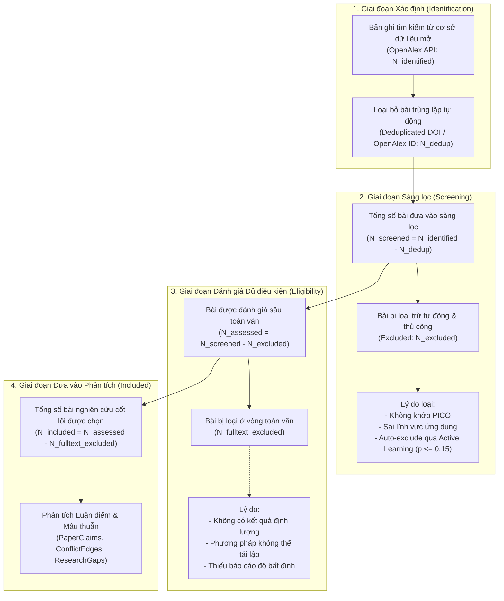

# 06. Quy chuẩn Systematic Review PRISMA 2020 & Xuất Báo cáo

Tài liệu này định nghĩa cách LitNexus tuân thủ theo tiêu chuẩn quốc tế **PRISMA 2020 (Preferred Reporting Items for Systematic Reviews and Meta-Analyses)**, thuật toán tính toán các chỉ số cho sơ đồ PRISMA Flow Diagram, và quy chuẩn xuất báo cáo tổng hợp nghiên cứu (BibTeX, Excel, Markdown).

---

## 1. Chuẩn PRISMA 2020 trong Nghiên cứu Khoa học

Khi xuất bản một bài báo Systematic Literature Review trên các tạp chí quốc tế uy tín (IEEE, ACM, Elsevier, Springer, Nature), các phản biện (peer reviewers) luôn yêu cầu một sơ đồ **PRISMA Flow Diagram** minh bạch, ghi rõ số lượng bài báo ở từng bước và lý do loại bỏ (exclusion reasons).

LitNexus tự động theo dõi từng trạng thái và nguồn gán nhãn trong cơ sở dữ liệu để sinh ra báo cáo PRISMA chuẩn xác mà nhà nghiên cứu không phải đếm thủ công.

---

## 2. 4 Giai đoạn của Sơ đồ Dòng chảy PRISMA 2020



---

## 3. Thuật toán Tính toán Chỉ số PRISMA từ Cơ sở Dữ liệu

Dữ liệu PRISMA được tổng hợp tự động bằng các câu lệnh truy vấn nhóm (aggregation queries) trên PostgreSQL:

```sql
-- 1. Tổng số bài đã ingest cho project
SELECT COUNT(*) AS total_ingested FROM papers WHERE project_id = :proj_id;

-- 2. Số lượng bài bị loại và nguồn phân loại
SELECT screening_status, screening_source, COUNT(*) 
FROM papers 
WHERE project_id = :proj_id 
GROUP BY screening_status, screening_source;

-- 3. Thống kê tỷ lệ tiết kiệm chi phí (Token Savings Rate)
SELECT 
    COUNT(*) FILTER (WHERE screening_source = 'active_learning') * 100.0 / NULLIF(COUNT(*), 0) AS al_automation_percentage,
    COUNT(*) FILTER (WHERE screening_source = 'human') AS human_labeled_count,
    COUNT(*) FILTER (WHERE screening_source = 'llm') AS llm_labeled_count
FROM papers 
WHERE project_id = :proj_id;
```

---

## 4. Định dạng Xuất Dữ liệu (Deliverables)

Nhà nghiên cứu có thể trích xuất kết quả từ LitNexus qua 3 định dạng phục vụ trực tiếp cho việc viết bản thảo bài báo (manuscript):

### 4.1. Tệp Thư mục BibTeX (`references.bib`)
Chứa toàn bộ trích dẫn của các bài báo thuộc nhóm `included`, tự động chuẩn hóa khóa trích dẫn theo định dạng `AuthorYear`:
```bibtex
@article{Smith2024,
  author    = {Smith, John and Zhang, Wei},
  title     = {Robust 1D CNN Architectures for Real-Time Arrhythmia Detection},
  journal   = {IEEE Transactions on Biomedical Engineering},
  year      = {2024},
  doi       = {10.1109/TBME.2024.1234567}
}
```

### 4.2. Bảng Ma trận Bằng chứng Thực nghiệm (`evidence_matrix.xlsx`)
Bảng tổng hợp chi tiết dành cho phụ lục (Appendix) của bài báo:
- Cột 1: Paper Title & Authors
- Cột 2: Publication Year & Scopus Quartile (Q1–Q4)
- Cột 3: Extracted Claim Text
- Cột 4: Evaluated Methodology
- Cột 5: Benchmarked Dataset
- Cột 6: Quantitative Metric Summary
- Cột 7: Stated Assumptions
- Cột 8: Verifiable Evidence Quote

### 4.3. Báo cáo Tổng hợp Khoảng trống Nghiên cứu (`RESEARCH_GAPS.md`)
Bản báo cáo học thuật tóm lược:
- Câu hỏi nghiên cứu trọng tâm (`research_question`).
- Đồ thị các cặp mâu thuẫn học thuật (`contradicts` / `assumption_mismatch`) kèm giả thuyết nguyên nhân gốc rễ (`root_cause_hypothesis`).
- Top 3 Research Gaps được xếp hạng theo điểm mới (`novelty_score`) kèm hướng thực nghiệm giải quyết gợi ý.
